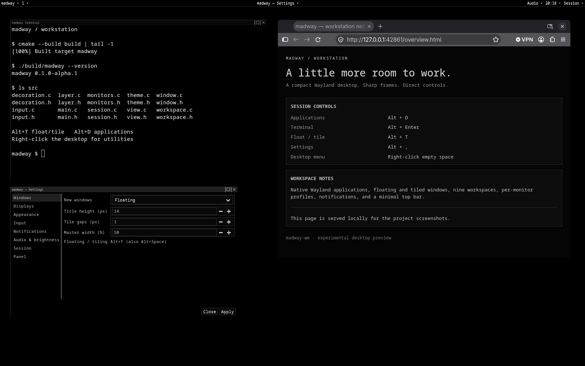

# madway-wm

An experimental C17 compositor using wlroots 0.20. The first preview is
**v0.1.0-alpha.1**; see [CHANGELOG.md](CHANGELOG.md) for its scope and limitations.
The current milestone displays native
Wayland application surfaces inside a nested session,
with keyboard/pointer input, master-and-stack tiling, floating windows, nine
workspaces, compact retro frames, notifications, launchers, wallpaper, session
sounds, a compact top bar, a desktop utility menu, and categorized settings.



[Desktop menu screenshot](docs/screenshots/desktop-menu.png) · [Audio mixer](docs/screenshots/panel-audio.png) · [Application search](docs/screenshots/launcher.png) · [Screenshot details](docs/screenshots/README.md)

The audio dropdown lists output devices, microphone/monitor inputs, and active
playback/recording streams. Each has a 0–100% volume slider and mute control;
outputs/inputs also offer default-device selection for new streams. Application
rows appear while a stream exists, so silent/inactive apps may not be listed.
Device changes are refreshed every two seconds. In a nested session, these are
the audio devices/streams of your existing sound server.

Hover **Applications**, **Settings**, **Window**, **Workspaces**, or **Session**
in the madway menu to open a list beside the parent. Click also opens the list;
Left returns, Right opens a focused submenu, and Escape closes it. Applications
includes installed visible desktop entries and a search action. **Alt+D** opens
a compact centered search palette; **Alt+Shift+D** searches commands/scripts.

**Alt+Tab** now shows a window list on the focused output. Hold Alt and press Tab
again to cycle, Shift+Tab to go backward, release Alt to keep the selection, or
press Escape to cancel. If the configured modifier is Super, use Super instead.
The list includes mapped windows on the current global workspace.

For tiled windows, **Ctrl+Shift+Left/Right** exchanges master/stack placement;
**Ctrl+Shift+Up/Down** reorders the stack. Settings → Input → **Focus on hover**
enables optional pointer-driven focus (off by default). Layout updates alone do
not change focus.

Settings → Appearance offers **Black**, **Amber workstation**, **Green terminal**,
**Slate blue**, and **Paper workstation** profiles, plus an explicit **Solid color**
or **Wallpaper image** background choice. Themes apply to madway's frames, panel,
menus, switcher, settings, launcher and notifications. Application-owned UI keeps
its own theme; background colour/image is chosen separately.

Use `madway-script FILE` for simple workflows and optional
`~/.config/madway/startup.madway` for startup commands. See the
[command syntax](docs/SCRIPTING.md), [example](examples/workstation.madway),
and [window switcher preview](docs/screenshots/switcher.png).

Settings → Panel → **Screen edge** places the panel at the top, bottom, left,
or right on each monitor. **Thickness** controls its height on horizontal edges
and width on vertical edges. Side panels use compact buttons and tooltips;
dropdowns open toward the desktop. Placement applies live and is saved.

Use the panel's **Window → Keep above others**, or **Alt+A**, to pin a window
above other applications, including fullscreen video. It stays on its workspace
and below shell panels/menus. This is useful for PiP; enable it on the PiP window.
The option toggles independently of floating/tiled mode. Super replaces Alt if
chosen as your modifier.

Resize tiles by dragging madway's shared 1px borders, or **Alt+right-drag** inside
a tile. Horizontal motion adjusts the master/stack split on that output; vertical
motion inside stack tiles adjusts a neighbouring pair of heights. The layout
keeps its gaps and tiles remain tiled. A single tile already fills the output;
outer output edges cannot be dragged outward. Split widths and window weights
are session state. Changing the default **Master width** setting resets width
overrides; new windows start with equal weight.

## Build

Requires CMake 3.20+, a C compiler, pkg-config, and development files for
`wlroots-0.20`, `wayland-server`, `xkbcommon`, `pangocairo` (Pango/Cairo text
rendering), and `gio-2.0`. Also requires `wayland-scanner`.

```sh
cmake -S . -B build
cmake --build build
```

## Start the desktop

From a terminal in your existing Wayland desktop, start madway:

```sh
WLR_BACKENDS=wayland WLR_RENDERER=pixman ./scripts/madway-session
```

The session wrapper starts a private D-Bus session and the desktop helper. This
lets applications inside madway use its notification manager while your host
desktop keeps its own. Launch applications from Kitty or the launcher inside
madway so they inherit both its Wayland socket and its D-Bus environment.
Running `./build/madway` directly starts only the compositor.

Desktop runtime dependencies: `python3` with PyGObject (`gi`), GTK 3, Gio, and GtkLayerShell 0.1
introspection bindings (`gtk-layer-shell`), `dbus-run-session`, **Mako**, **Wofi**, **swaybg**, **Kitty**,
`notify-send`, **WirePlumber** (`wpctl`), and **pactl** (`libpulse` on Arch).
The audio mixer requires a PulseAudio-compatible server, such as **pipewire-pulse**. Sounds use `pw-play` (PipeWire) or
`paplay` (PulseAudio). Brightness uses optional `brightnessctl`, otherwise logind
through `busctl`. These programs are already installed here except brightnessctl.

```sh
./scripts/madway-shell doctor
```

Madway prints its own socket name, for example:

```text
Listening on WAYLAND_DISPLAY=wayland-1
```

Focus the outer madway window and press **Alt+Enter** to launch Kitty on the
active workspace. Kitty must be installed and available on `PATH`.

Alternatively, from a second terminal in your existing desktop, launch Kitty.
Replace `wayland-1` with the name printed by madway:

```sh
WAYLAND_DISPLAY=wayland-1 kitty -o linux_display_server=wayland
```

New normal windows **float by default**. Choose Floating or Master/stack in
Settings → Windows to set the policy for future windows. Use **Alt+T** to switch
the focused window between floating and tiled (Alt+Space remains an alias).
When tiling, the first tile is the master on the left, with later tiles stacked
on the right. Master width is configurable from 25% to 75%. There is 1 logical pixel between
tiles and no outer padding. A single tile occupies the output. Focus changes do
not reorder the tiles. New windows use the output under the pointer when possible.

To prioritize application space, tiled server-decorated windows have only a 1px
border; no title bar. The focused tile has a light gray border. Floating windows have
a 14-logical-pixel title bar by default, 1px bevels, a monospace title, and square maximize/
close controls. Inactive floating titles are slate gray. Title images are cached
until their text, size, or state changes. Dialogs with a parent window float by
default.

Applications explicitly requesting client-side decorations keep drawing their
own frame. Applications that do not use decoration negotiation (including some
GTK applications) also keep their own chrome. Kitty's
`hide_window_decorations=yes` opts out of madway's frame. Remove that override to
try the compositor's decorations. Application toolbars and tabs remain under
application control.

The border around the outer nested window belongs to your host desktop;
madway's frames surround individual applications inside it.

New windows receive keyboard focus automatically. Click a window to focus and
raise it; click the background to clear keyboard focus. You can type commands,
use modifier keys, select text with the mouse, and scroll. Pointer movement
alone does not change keyboard focus. Closing the focused window restores focus
to the topmost remaining mapped window.

Press Alt+Escape while madway receives keyboard input to exit. Your host
desktop may reserve shortcuts; Ctrl+C in the terminal running madway is also
available. The nested window must have focus in your host desktop to receive
keyboard input.

## Workspace and window controls

All shortcuts below use Alt by default. Settings → Input can switch the modifier
to Super for both shortcuts and move/resize gestures. Their press and release events are
consumed by madway, so they do not become terminal input.

| Keys | Action |
| --- | --- |
| Enter | Launch Kitty on the active workspace |
| D | Search installed applications (Wofi drun) |
| Shift + D | Run an executable or script from PATH (Wofi run) |
| Comma | Open madway settings |
| 1 through 9 | Switch workspace |
| Shift + 1 through 9 | Move the focused window to that workspace without following it |
| T / Space | Toggle floating/tiled; restore a maximized/fullscreen window to floating |
| F | Toggle the focused application's fullscreen state |
| M | Maximize / restore |
| Tab / Shift+Tab | Cycle focus forward / backward in stable window order |
| Q | Request that the focused application close |
| Escape | Exit madway |

Workspace selection is global across outputs in this version. Hidden-workspace
windows retain their application state but are removed from scene visibility and
keyboard focus. Switching back restores focus to the topmost visible window.
Floating/tiled state and normal floating geometry are retained. An output resize
or removal recomputes the layout and reassigns windows from a removed output.

Fullscreen uses the entire madway output: no madway title bar, border, or gaps.
Other windows on that output are hidden until fullscreen ends or focus cycles to
another window. Exiting fullscreen restores the preceding tiled/floating state.
The application can also request fullscreen itself, for example Firefox's F11.

The **outer nested window** is managed by your existing desktop. Use that
desktop's fullscreen/window-menu action to make madway itself fill the physical
monitor; Alt+F controls an application inside madway. The experimental native
session runs directly on physical outputs without this outer host window; see
[installation](docs/INSTALL.md).

## Floating-window gestures

| Action | Control |
| --- | --- |
| Move | Drag madway's title bar, or Alt + left drag inside a window |
| Resize | Drag the 1px frame edges/corners, or Alt + right drag inside a window |
| Maximize / restore | Click the square title-bar button |
| Close | Click the title-bar X, or exit the application normally |
| Fullscreen | Alt+F, or the application's fullscreen action |

Applications can also request interactive move/resize through their own
decorations; requests are validated against the pointer grab serial. Move and
resize gestures apply to floating windows. Press Alt+T to float a tile
first. Restore maximized/fullscreen windows before moving or resizing them.
Resizing respects application minimum/maximum size hints. When resizing the
left/top edges, the opposite edge remains anchored while the client acknowledges
and draws the requested size. The nested outer window can still be resized
using your host desktop. Host shortcuts may intercept Alt gestures.

XDG popups now get an initial configure, a scene surface, and output constraints.
The standard clipboard data-device protocol and primary-selection protocol
are supported. Primary selection is separate from the regular clipboard. Minimizing/restoring hidden windows, arbitrary key bindings,
clipboard persistence, and Xwayland
remain future work. Very constrained layouts and clients that decline suggested
tile sizes need further compatibility work.

Keyboard layouts use the backend keymap when available,
otherwise the default XKB keymap. Repeat defaults to 25 keys/second after
a 600 ms delay and can be changed live in Settings → Input.

Close the outer madway window or press Ctrl+C in the terminal running madway to
stop the compositor. Client connections are closed during shutdown.

## Desktop services and settings

**Alt+Comma** opens the settings window. It controls wallpaper image/fit/color,
floating title height (12–24px), tile gaps (0–12px), notifications, session sounds,
volume, and brightness. Settings are divided into Windows, Displays, Appearance,
Input, Notifications, Audio & brightness, Session, and Panel categories. The settings
window uses madway’s own title bar, capped at 14px, instead of GTK’s larger header. Apply saves `~/.config/madway/settings.ini` (or
`$XDG_CONFIG_HOME/madway/settings.ini`) and updates the running session. The
provided `share/madway/settings.ini` documents the defaults. Tiled windows still
have no title bar; fullscreen applications have no madway borders or gaps.

Mako displays application notifications at the top right with square gray
borders. Volume up/down/mute and brightness up/down keys work without modifiers
and display short percentage/progress notifications. Changes use 5% steps;
volume is capped at 100% and brightness at 1–100%. The settings sliders offer
explicit values. Brightness requires a supported backlight and session access;
external monitor brightness/DDC is not implemented. In a nested session these
controls affect the host machine. Your host desktop may intercept multimedia
keys or Alt shortcuts before madway receives them.

Wofi provides two launcher modes: **Alt+D** searches installed `.desktop`
applications, and **Alt+Shift+D** searches executable commands/scripts. Put your
own executable scripts in `~/.local/bin`; this directory is added to the helper's
PATH. Escape closes the launcher and restores application focus. A launcher
uses an overlay only while open, so it reserves no permanent screen area.

Swaybg manages the wallpaper on the background layer. Choose an image in
settings or leave the path empty for a solid color. Supported image fitting
modes are fill, fit, center, stretch, and tile. Settings and launcher windows
use the same compact black/grayscale monospace styling as the compositor.

No wallpaper images or sounds are bundled or selected by default. The personal
`longhorn assets/` directory is ignored by Git and excluded from installation.
Session sounds are disabled by default. To use your own clips, set
the Startup, Logout, and Shutdown sound files in settings (or
`sounds.startup`, `sounds.logout`, and `sounds.shutdown` in the INI file), then
enable Session sounds and click Apply. The Sound test button saves the current
settings and previews the startup clip. Playback requires a format
supported by the selected audio player.

When configured, shutdown through the settings window plays its clip before
requesting `systemctl poweroff`; this
button shuts down the **whole computer**, including when madway is nested.
Shutdown initiated elsewhere is detected through logind's PrepareForShutdown
signal, with best-effort playback while audio is still available. The settings
window offers a sound preview and sound level for configured clips.

The small desktop helper owns these programs and stops them on logout. The
compositor handles layer-shell positioning, focus, and rendering; external
services supply notifications, wallpaper pixels, and launcher content. This
keeps hardware commands and desktop UI work outside the compositor event loop.
Settings also cover the default window mode, master width, repeat rate/delay,
Alt/Super modifier, notification position/width/timeout, media indicators, and
volume/brightness key steps. Keyboard-layout editing, network management, and
arbitrary key binding editing remain future settings pages.

For a local installation, configure the intended prefix before building:

```sh
cmake -S . -B build -DCMAKE_INSTALL_PREFIX="$HOME/.local"
cmake --build build
cmake --install build
```

Then run `~/.local/bin/madway-session`. For a native login entry and system installation, use the
[installer](docs/INSTALL.md); physical hardware validation remains open.

## Top bar and desktop menu

An 18px black top bar appears on each output. Apps, Run, and Settings are grouped
under **madway**. Every remaining control opens a dropdown: workspace selection,
active-window actions, system status, audio/brightness, clock, and session tools.
The status dropdown shows CPU/RAM readings; clock and status menus link to their
options. Narrow outputs hide optional status/session controls. Panel settings
control visibility, height (16–32px), telemetry, and the clock. Tiling and
maximization reserve the bar's space; fullscreen applications hide it on their
output. Custom title bars default to 14px, tile gaps to 1px, and shell/menu text
uses smaller monospace fonts with tighter padding and neutral gray focus states.

Click **madway** or **right-click empty desktop space** to open the same compact
menu. It contains application/command launchers, Kitty, settings categories,
window actions, workspaces, and session utilities. Application right-clicks remain
with the application. The menu supports arrows, Enter, Escape, and outside-click
dismissal. Its settings shortcuts switch categories without discarding unsaved
edits in an already-open settings window. Computer shutdown stays behind the
settings confirmation.

The panel is a GTK layer-shell client; `madway-panel` ships alongside the helper.
The compositor supplies reserved output space, menu focus, a private desktop
control socket, and state for active titles/workspaces. `grim` screenshots use
the standard screencopy protocol.

## Installing on a real machine

On CachyOS/Arch, from the checkout as your normal user:

```sh
./scripts/install-madway --dry-run
./scripts/install-madway --deps
```

Then log out and select **madway (experimental)** in your login screen. This adds
a session alongside your existing desktop. See [INSTALL.md](docs/INSTALL.md) for
staging, paths, requirements, native VT controls, and current limitations. The
installer and launcher are tested in staging; a physical DRM session is not yet
validated here.

## Multiple monitors

Settings → Displays lists connected madway outputs. Each has an enable switch,
resolution/refresh selector, logical X/Y position, scale, and rotation/flip.
Positions use logical pixels after scaling and rotation: to place a 1920px-wide
screen at scale 2 beside another output, allow 960 logical pixels for its width.
Click Apply to save profiles under `[output:NAME]` in the personal INI file.
Profiles are reapplied on restart and when a named monitor reconnects. Refresh
connected monitors after hotplug to refresh the form. At least one monitor must
remain enabled; unsupported configurations are rejected and reported in settings.

Each nested pointer is mapped to its own output before its local coordinates
enter the shared pointer coordinate space. Nested cursors render in the output
scene to avoid exhausting the host cursor-buffer queue.

Outputs share the pointer coordinate space. Newly opened floating windows use
the output under the pointer, windows follow output repositioning, and windows
from a removed/disabled output are moved to a remaining output. Fullscreen and
tiling use each output's own dimensions. Workspaces remain global across outputs.
The standard wlr-output-management protocol is also exposed for tools such as
`wdisplays`; its live changes are not automatically written to madway's INI file.

In a nested session these settings configure madway's virtual outputs, rather
than your host desktop's physical monitors. To try two nested outputs:

```sh
WLR_BACKENDS=wayland WLR_WL_OUTPUTS=2 WLR_RENDERER=pixman ./scripts/madway-session
```

This creates two host windows that you can place on your physical screens.
Physical monitor configuration
requires running madway directly on the hardware backend. Physical DRM modes
and hardware scaling have not yet been verified on this machine; integration
checks use virtual outputs.

## Validation

The desktop smoke test starts a headless compositor on its own Wayland socket
and private D-Bus session, with a temporary HOME and mock audio/backlight tools.
It exercises real Mako notifications, swaybg, both Wofi modes with injected
keyboard input, the GTK settings window, multimedia shortcuts, live configuration
reload, compact categorized settings/form saves, default floating and Alt/Super
shortcuts, monitor modes/layout/scale/rotation, hotplug recovery, profile restore
after restart, and startup/logout/shutdown sound events. It does not change host volume,
brightness, play audio, or request a shutdown.

```sh
cmake --build build
dbus-run-session -- python3 tests/desktop_smoke.py
dbus-run-session -- python3 tests/nested_pointer_smoke.py
python3 tests/installer_smoke.py
```

The nested-pointer regression uses a private headless parent and two real
nested Wayland outputs. It verifies that each host window's pointer maps to its
own output, that empty-screen clicks do not reach another screen, and that
clicking, dragging, resizing, and layout reordering work with real Kitty clients.
It also checks cursor-image reuse on background motion and, when `wl-copy` and
`wl-paste` are installed, primary-selection transfer between real clients.
It requires Wayland client development files in addition to the build dependencies.

## Firefox diagnostics

Applications launched inside a madway terminal inherit its `WAYLAND_DISPLAY`.
For a reproducible Firefox test that does not reuse an existing browser/profile,
run this from a host terminal, substituting madway's printed socket name:

```sh
madway_firefox_profile="$(mktemp -d /tmp/madway-firefox.XXXXXX)"
MOZ_ENABLE_WAYLAND=1 WAYLAND_DISPLAY=wayland-1 firefox --no-remote \
    --profile "$madway_firefox_profile" about:blank 2>/tmp/madway-firefox.log
```

This creates a separate temporary profile. The crash reporter indicates that
Firefox crashed; it does not by itself establish the cause. Keep Firefox's log
and madway's terminal output when reproducing a crash. Testing covered a fresh
Firefox window and a context-menu popup; broader browser compatibility still
needs testing.

## Read the implementation

- `src/main.c`: startup, socket creation, outputs, scene rendering, and shutdown.
- `src/main.h`: server and output state.
- Every C implementation has a matching header (`view.h`, `input.h`, `window.h`,
  `decoration.h`, `workspace.h`, `layer.h`, `monitors.h`, and `session.h`). The header declares its public interface;
  private callbacks remain inside its `.c` file. Headers use forward declarations
  for peer objects to avoid circular includes. `view.h` owns application state.
- `src/view.c`: XDG toplevel creation, initial configure, map/unmap, and cleanup.
- `src/window.c`: move/resize geometry, size constraints, maximize/fullscreen,
  and restoring the previous geometry.
- `src/decoration.c`: compact frame geometry, cached Pango/Cairo title buffers,
  and hit testing for title-bar controls and borders.
- `src/input.c`: seat capabilities, keyboard/pointer devices, cursor events,
  hit testing, shortcuts, desktop action dispatch, event forwarding, and input cleanup.
- `src/workspace.c`: scene visibility, stable master/stack geometry, workspace
  switching, moving windows between workspaces, and tiled/floating transitions.
- `src/layer.c`: wallpaper/background, panel, notification and launcher layers,
  reserved output areas, and keyboard focus for interactive overlays.
- `src/monitors.c`: output configuration/testing, layout, persistent profiles,
  and monitor information for settings.
- `src/session.c`: child process launch, helper lifecycle, settings reload, and
  nonblocking desktop action messages.
- `scripts/madway-panel`: multi-output top bars and the shared desktop menu.
- `scripts/install-madway`: dependency checks and native-session installation.
- `scripts/madway-shell`: desktop service supervision, hardware controls, sounds,
  and the GTK settings window. Matching configs and sounds live in `share/madway`.

The application lifecycle is:

```text
connect to socket -> request XDG toplevel -> initial empty commit
    -> madway sends configure -> client acknowledges and attaches pixels
    -> map -> scene renders application contents
    -> unmap/destroy -> listeners and window state are released
```

Input follows a separate path:

```text
backend device -> keyboard/cursor event -> madway handler
    -> seat -> focused application surface
```

The output layout supplies shared display coordinates. Pointer hit testing
converts those coordinates to coordinates inside an application surface. Mouse
button drags stay with the surface where the first button was pressed until
all buttons are released.
