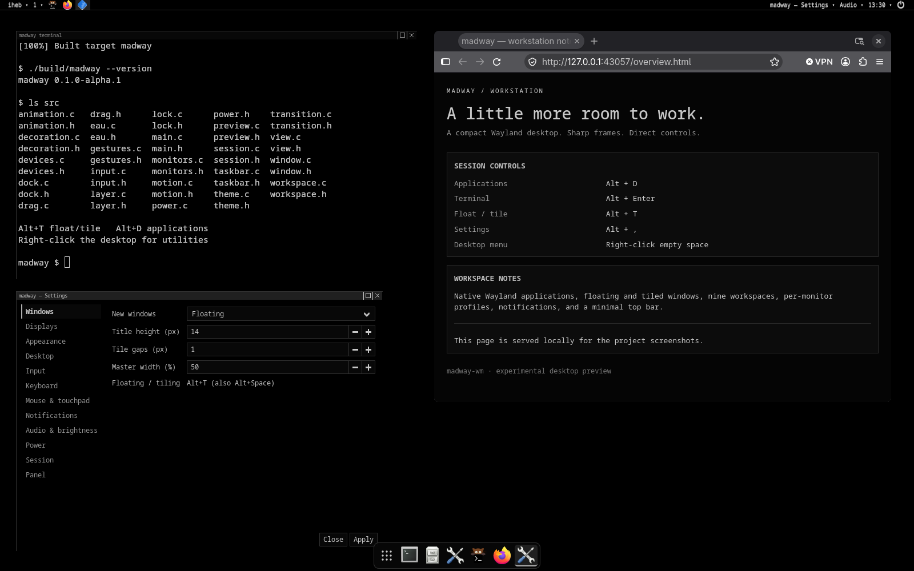

# madway-wm

**madway** is an experimental Wayland compositor and desktop written in C17 with
wlroots 0.20. It combines compact workstation chrome, floating and tiled windows,
and a configurable desktop shell. Run it inside an existing Wayland desktop for
development, or select it from your login screen for a native hardware session.

The latest tagged preview is **v0.1.0-alpha.1**. This branch includes the
[Unreleased changes](CHANGELOG.md), including desktop files, drag-and-drop,
window previews, animations, laptop power management and screen locking.



[Desktop menu](docs/screenshots/desktop-menu.png) ·
[Audio mixer](docs/screenshots/panel-audio.png) ·
[Application search](docs/screenshots/launcher.png) ·
[Window previews](docs/screenshots/switcher.png) ·
[Compact settings](docs/screenshots/settings.png) ·
[Desktop files](docs/screenshots/desktop-files.png)

These are real captures from isolated test sessions with temporary homes and
fixture content. See [screenshot details and regeneration](docs/screenshots/README.md).
Konsole is the default terminal; the workstation capture uses Kitty as another
native Wayland client.

## What works

- **Customization:** a single searchable settings sidebar with expandable groups,
  sectioned forms, themed switches/buttons, and separate sound preferences.
  Appearance controls cover themes/colors, typography, icons, wallpaper, animations,
  panel widgets, dock contents and desktop icons.
  The dock editor adds/removes/reorders installed applications. Display settings
  include draggable monitor previews with edge snapping and scale/rotation.
- **Window management:** floating by default, master/stack tiling, nine independent
  workspaces per monitor, fullscreen, maximize, minimize, keep-above and resizable tiles.
  Alt+Tab shows image previews, including covered and minimized windows.
- **Compact shell:** a panel on any of the four screen edges, cascading utility
  menus, a taskbar with icons or application names, and an existing Waybar dock
  with a StatusNotifier tray. Task entries minimize, focus or restore windows.
  The dock can hide behind maximized applications and slide out on edge hover.
  Right-click a running dock icon or panel task to keep its launcher in the dock.
  Panel contents have a 10px inset at both ends. A dedicated power icon opens
  session controls: lock, sleep, log out, restart and shut down.
- **Desktop files:** icons from the XDG Desktop directory (normally `~/Desktop`),
  live updates, folder/text-file creation, rename, copy/paste, Trash and grid
  reordering. Native Wayland drag-and-drop works between applications and the
  desktop. Right-click empty space to show or hide desktop icons.
  Wrapped filenames occupy fixed cells, keeping the first row aligned with the rest.
- **Appearance:** Black, Amber workstation, Green terminal, Slate blue, Paper
  workstation, Argent Silver and Argent Midnight themes. Solid backgrounds,
  wallpaper images and folder/image-selection slideshows with an enable/pause
  switch. Workspace, minimize, maximize, close and dock motion follows output frames
  with configurable cubic Bézier animations.
  Wallpaper changes crossfade; search fades/slides, and warm media indicators
  appear immediately with animated volume/brightness bars and background hardware control.
  Logout, restart and shutdown offer a simple fade or nine custom shaders,
  synchronized sound, and a matching opening reveal. Duration controls and safe
  previews are under Appearance → Session effects.
- **Desktop utilities:** native Spotlight application search with faint inline
  autocomplete, Wofi command search, Mako notifications,
  per-device and per-application audio sliders, multimedia-key indicators,
  brightness controls, screenshots saved to PNG and copied to the clipboard,
  and optional personal session sounds.
  Startup plays on the first native login after boot; later logins use a separate
  logon sound. Public installs include no personal wallpaper or audio files.
  Search uses a compact Spotlight-style surface with app icons and soft selection
  highlights; Alt+Tab uses matching preview cards with app icons and title captions.
- **Hardware and input:** multi-monitor layout, modes, scaling and rotation;
  live keyboard layout/repeat settings; mouse and touchpad settings, including
  native tap-to-click and three-finger workspace swipes; application pinch/hold
  gesture support and optional focus on hover.
- **Laptop sessions:** battery level and warnings, configurable lid behavior,
  logind sleep/resume, and lock-before-sleep using swaylock and the Wayland
  session-lock protocol. Locking waits for protected frames on enabled outputs.
- **Automation:** a small `.madway` command language, a CLI and optional startup
  scripts. Settings apply live and persist across sessions.

## Build and try it

Madway targets Linux and does **not** require CachyOS or a running KDE/Plasma
desktop. The checkout requires wlroots **0.20** and the libraries/tools below;
availability and package names vary by distribution. Konsole needs its KDE
libraries, while sleep/lid/brightness integration uses systemd-logind. The
installer's `--deps` package step supports Arch/CachyOS; install dependencies
manually on other distributions. Other operating systems and all GPU/driver
combinations are not verified. See [portability and customization](docs/CUSTOMIZATION.md).

Build requirements: a C17 compiler, CMake 3.20+, pkg-config, `wayland-scanner`,
and development packages for **wlroots-0.20**, **wayland-server**, **xkbcommon**,
**pangocairo**, **gio-2.0**, **libinput** and **pixman-1**.

```sh
git clone git@github.com:Iheb-AG/madway-wm.git
cd madway-wm
cmake -S . -B build
cmake --build build
```

The desktop shell uses Python 3, PyGObject with GTK 3 and GtkLayerShell bindings,
`dbus-run-session`, Mako, Wofi, swaybg, swaylock, Konsole, Waybar, grim, slurp,
wl-clipboard, xdg-user-dirs and `notify-send`. Audio controls use `wpctl` and
`pactl`, with a PulseAudio-compatible server such as pipewire-pulse. Brightness
uses optional `brightnessctl`, falling back to logind through `busctl`. Personal
sounds use `pw-play` or `paplay`. Connectivity settings use optional NetworkManager
(`nmcli`, `nm-connection-editor`) and BlueZ/Blueman tools; see
[system settings dependencies](docs/SYSTEM_SETTINGS.md#connectivity).

Check the installed tools, then start a nested desktop:

```sh
./scripts/madway-shell doctor
WLR_BACKENDS=wayland WLR_RENDERER=pixman ./scripts/madway-session
```

Focus the new madway window and press **Alt+Enter** for Konsole. Launch other
applications from that terminal or the launcher so they inherit the session's
Wayland and D-Bus environment. Running `./build/madway` alone starts only the
compositor, without the desktop services.

To test two nested outputs:

```sh
WLR_BACKENDS=wayland WLR_WL_OUTPUTS=2 WLR_RENDERER=pixman ./scripts/madway-session
```

These are two host windows. Nested display settings configure those virtual
outputs; your existing desktop manages the physical monitors and the outer
window's frame. Your host may intercept shortcuts before madway receives them.
Alt+Escape exits madway; Ctrl+C in its launching terminal also stops it.

## Install a native login session

From the checkout, as your normal user:

```sh
./scripts/install-madway --dry-run
./scripts/install-madway
```

On Arch/CachyOS, use `./scripts/install-madway --deps` to also install missing
build/runtime packages through pacman. The installer builds in `build-install`,
installs under `/usr/local`, and adds a **madway (experimental)** login choice.
It uses sudo for system installation and preserves personal settings.
Log out normally, then select madway from the login screen.

For staging, paths, native-session requirements and troubleshooting, read the
[installation guide](docs/INSTALL.md). Automated checks use virtual outputs and
staged installations; native DRM/GPU behavior still needs hardware testing.

## Controls

The default modifier is **Alt**. Change it to Super in **Settings → Input**;
that also changes the move/resize gestures. The table spells out the default
bindings.

| Shortcut | Action |
| --- | --- |
| Alt+Enter | Launch Konsole |
| Alt+D / Alt+Shift+D | Search applications / run commands or scripts |
| Alt+Comma | Open settings |
| Alt+B | Show / hide the panel |
| Alt+Tab / Alt+Shift+Tab | Cycle window previews; release Alt to select, Escape to cancel |
| Alt+1…9 | Switch workspace |
| Alt+Shift+1…9 | Move the focused window to a workspace without following |
| Alt+T / Alt+Space | Toggle floating/tiling |
| Alt+Shift+Enter | Put the focused tile into the master slot |
| Alt+F | Toggle application fullscreen |
| Alt+M | Maximize / restore |
| Alt+A | Toggle keep above other applications |
| Alt+Q | Request application close |
| Alt+L | Lock the screen |
| Alt+Escape | Exit madway |
| Ctrl+Shift+Left/Right | Exchange master/stack placement |
| Ctrl+Shift+Up/Down | Reorder the tiled stack |
| Alt+left drag | Move a floating window |
| Alt+right drag | Resize a floating window or shared tile boundaries |
| Three-finger swipe left / right | Next / previous workspace, on release |
| Print / Ctrl+Print | Save a full screenshot and copy it to the clipboard |
| Shift+Print | Select an area, save it and copy it to the clipboard |
| Volume / brightness keys | Adjust the level and show an indicator |

Click a taskbar/dock entry to minimize the focused window or focus/restore an
inactive one. The Window menu and Alt+Tab can also restore minimized windows.
Right-click empty desktop space for file actions and desktop controls; the
username menu in the panel provides application and session utilities.
Keyboard screenshot shortcuts keep an open panel menu in the capture.

Floating frames default to 14px titles in compact themes and 22px in Argent.
Server-decorated tiles use a 1px border without a title bar; fullscreen removes
madway's borders, gaps and panels on that output. Applications that draw their
own decorations, toolbars and tabs retain control of them.

Workspaces are shared across outputs. Tiling uses each output's own work area;
new floating windows prefer the output under the pointer. Removing/disabling
an output moves its windows to a remaining one. At least one output must stay
enabled in display settings.

Three-finger workspace swipes are enabled by default. Configure their enable
switch, reverse direction and minimum distance in **Settings → Mouse & touchpad**.
Short, mostly vertical or cancelled swipes do not switch; workspace boundaries
do not wrap. Switching uses the existing workspace animation after release.
Two-finger scrolling continues normally, and pinch/hold gestures are forwarded
to applications that support them. Native touchpad gesture recognition comes
from libinput; nested sessions depend on the host forwarding gestures.

## Settings and appearance

Open **Alt+Comma**. Categories cover Windows, Displays, Appearance, Desktop,
Input, Keyboard, Mouse & touchpad, Notifications, Audio & brightness, Power,
Session and Panel. Apply writes
`${XDG_CONFIG_HOME:-$HOME/.config}/madway/settings.ini` and updates the running
session. [The default INI](share/madway/settings.ini) documents the available options.

The panel uses your account name by default. Set its label to `@user`, `groxiv`
or another name in Panel settings. Both panel and dock support all four edges;
taskbar entries can show only icons or only application names.
Hover an application task to see its window thumbnail and title. Click the clock
for a month calendar with week numbers and date/time settings. Panel settings
can disable preview tooltips. The Window menu can swap a tile with another
application; Alt+Shift+Enter makes the focused tile master.

The light Argent panel uses an opaque silver gradient to keep wallpaper lines
out of its background. The session button is visible in every theme and on all
four panel edges. Sleep is available in native sessions; restart and shutdown
open a centered, themed confirmation card, without opening Settings. Logout from
the panel and settings uses the same card; Cancel is initially focused.

Settings now groups **Network** and **Bluetooth** under Connectivity, alongside
**Default applications**, **Date & time**, and **About** under System. Network
status, scans, radio controls and saved connections use NetworkManager;
authentication opens Konsole. Advanced connection and pairing editors are
optional existing utilities. See [system settings](docs/SYSTEM_SETTINGS.md) for
packages, the KDE Plasma comparison, and remaining gaps.

Apply the Argent presets in Appearance settings or with:

```sh
./scripts/madway-shell preset argent
# Dark variant:
./scripts/madway-shell preset argent-dark
```

No wallpaper images or sounds are bundled in the public checkout. A solid
background works without media. Choose your own wallpaper or slideshow images
in Appearance and sound files in Sounds. Session sounds are off by
default. Longhorn assets, a locally supplied wallpaper and all local
demoscene payloads are Git-ignored. The optional Demoscenes menu/build integration
is available when a local package exists; the desktop builds without it.

Sounds has separate **Startup sound** and **Logon sound** selectors.
The first native madway login per user after reboot uses Startup; later logins
use Logon. A nested preview uses Logon and does not consume the boot marker.
If an older personal configuration has only a startup file, a neighboring
`login`/`logon` audio file is picked up when available. Empty sound fields stay silent.

The audio menu lists output/input devices and active playback/recording streams,
with volume, mute and default-device controls. Silent applications may have no
stream to show. In a nested session, audio and brightness controls affect the
host hardware. The confirmed power-off action shuts down the whole computer.

| Guide | Details |
| --- | --- |
| [Desktop files](docs/DESKTOP_FILES.md) | Icons, right-click actions, copy/paste, Trash and drag-and-drop |
| [Desktop integration](docs/DESKTOP_INTEGRATION.md) | Dock, taskbar, Telegram tray, screenshots and Midnight |
| [Settings & exit effects](docs/SETTINGS_AND_EXIT_EFFECTS.md) | Searchable compact forms, shader choices, previews and failure handling |
| [System settings](docs/SYSTEM_SETTINGS.md) | Connectivity, default apps, calendar, tile swaps, settings audit and system utilities |
| [Argent themes](docs/THEMES.md) | Silver/Midnight profiles and optional local media |
| [Input and workspaces](docs/INPUT_AND_WORKSPACES.md) | Keyboard, touchpad, tile controls and animations |
| [Previews and slideshows](docs/PREVIEWS_AND_SLIDESHOWS.md) | Alt+Tab images, slideshow sources, interval and enable/pause |
| [Power management](docs/POWER.md) | Battery warnings, lid policy, sleep and resume |
| [Screen locking](docs/LOCKING.md) | swaylock, lock-before-sleep, recovery and limitations |
| [Scripting](docs/SCRIPTING.md) | Command syntax and startup scripts; [example](examples/workstation.madway) |

## Rendering recovery and diagnostics

Output commits now recover from transient failures without requiring mouse or
keyboard activity. Failed frames retain their damage and retry per output,
starting at its refresh period and backing off to at most 250ms. Retries stop
while outputs are inactive or sleeping. Idle outputs otherwise stay idle.
This addresses the frame-callback stall seen during fullscreen playback after
DRM reported `Device or resource busy`; browser/native-driver validation remains
necessary on affected hardware.

Native session logs are stored at
`${XDG_STATE_HOME:-$HOME/.local/state}/madway/session.log`, with a runtime-log
fallback if persistent storage is unavailable. Look for output commit failures
and `Scene commits recovered` messages. See [installation diagnostics](docs/INSTALL.md)
for black-screen startup and fullscreen playback troubleshooting.

madway currently supports native Wayland clients. Xwayland, arbitrary keybinding
editing, clipboard persistence and a complete portal/polkit
setup remain future work. Very constrained tile sizes and GPU-specific behavior
need further compatibility testing.

## Validation

The integration tests use private headless/nested Wayland sockets, temporary
homes and fixture tools for hardware actions. They do not authenticate against
the host session or suspend it. Useful checks from the repository root:

```sh
cmake --build build
python3 tests/files.py
dbus-run-session -- python3 tests/desktop_smoke.py
dbus-run-session -- python3 tests/desktop_experience.py
dbus-run-session -- python3 tests/desktop_files.py
dbus-run-session -- python3 tests/nested_pointer_smoke.py
python3 tests/frame_recovery.py
python3 tests/gestures.py
python3 tests/session_sounds.py
python3 tests/installer_smoke.py
```

The desktop checks cover actual settings, menus, launchers, notifications,
clipboard/file operations and drag-and-drop. The nested-pointer test checks two
real nested outputs with Kitty clients. The frame-recovery test injects failed
commits into a fullscreen frame-callback client at 60/100Hz, including bounded
retry backoff and simulated sleep/resume. It does not reproduce a physical GPU
failure. Additional locking, power, dock, input, preview and slideshow checks are
listed in their feature guides. Integration fixtures also require Wayland client
development files and the desktop tools used by the test.

## Read the implementation

Each compositor module has a matching `.h` interface; private callbacks stay in
its `.c` file.

| Source | Responsibility |
| --- | --- |
| `src/main.c` | Display/socket startup, outputs, scene rendering, commit recovery and shutdown |
| `src/view.c`, `src/window.c` | XDG application lifecycle, geometry, fullscreen/maximize and constraints |
| `src/decoration.c`, `src/argent.c`, `src/theme.c` | Frames, cached titles, Argent chrome and shared theme data |
| `src/input.c`, `src/devices.c`, `src/gestures.c`, `src/drag.c` | Seat/input routing, shortcuts, device preferences, touchpad gestures and native drags |
| `src/workspace.c`, `src/monitors.c` | Tiling, workspaces, output layouts and persistent monitor profiles |
| `src/layer.c`, `src/taskbar.c`, `src/dock.c` | Desktop layers, foreign-toplevel controls and dock visibility |
| `src/preview.c`, `src/transition.c`, `src/motion.c`, `src/effects.c`, `src/animation.c` | Window previews, workspace/window/layer motion and shared timing |
| `src/power.c`, `src/lock.c`, `src/session.c` | Sleep/lock state, process supervision and desktop action messages |
| `scripts/madway-shell`, `scripts/madway-panel` | Settings, services, hardware controls, panel and utility menus |
| `scripts/madway-desktop`, `scripts/madway_files.py` | Desktop icon surfaces and file operations |
| `scripts/madway_apps.py`, `scripts/madway_sound.py` | Application lookup/dock pins and boot/logon sound selection |
| `scripts/install-madway` | Dependency checks and native-session installation |

Application rendering follows this lifecycle:

```text
client connects → requests XDG toplevel → initial empty commit
  → madway configures → client acknowledges and attaches pixels
  → window maps → output scene renders → frame callback lets client continue
```

Input follows `backend device → madway handler → seat → focused client surface`.
The scene and output layout supply shared coordinates for rendering and pointer
hit testing. Desktop utilities run as separate clients so file operations,
settings and hardware commands stay outside the compositor's rendering loop.
